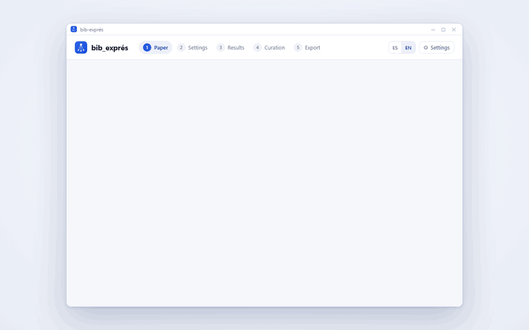

<div align="center">


# bib_exprés

**De un paper a tu bibliografía, sin cajas negras.**

[English](README.md) · **Español**

[](https://github.com/AIAYN-creator/Bib-Expres/releases/latest)
[](LICENSE)



</div>

## Qué hace

Le das **un paper** (DOI, arXiv, título o el propio PDF) y bib_exprés hace el *snowballing* por ti. Sigue sus referencias, los papers que lo citan y los artículos similares, guarda todo lo que ve y elige los mejores con un score que se puede leer: **cuánto se parece el tema, cuántos papers de tu búsqueda apuntan a él y qué palabras clave comparte con el tuyo**. Te entrega una bibliografía lista para Zotero, LaTeX o Excel, y cada entrada puede decirte por qué está ahí.

```
paper de entrada
  -> resolución (CrossRef + OpenAlex)                  -> paper raíz
  -> exploración (los mejores primero, hasta 21 papers por defecto)
       -> OpenAlex: referencias + citas
       -> Semantic Scholar: artículos similares (opcional)
       -> se guarda cada candidato visto, con cuántos papers explorados lo enlazan
  -> selección: relevancia + conexiones + palabras clave -> los N mejores, y luego los filtros
  -> curación opcional (guardar / descartar uno a uno)
  -> exportación -> .bib / .ris / .json / .xlsx
```

## Rendimiento

**2,4 veces más de la bibliografía que importa, en un minuto.** Medido contra la bibliografía de tres revisiones publicadas (machine learning, biología molecular y física), bib_exprés v3 encuentra de media el **24 %** de lo que cita cada revisión entre sus 200 primeros resultados, frente al 9,9 % de v2, y el 50 % en el caso de CRISPR. Una búsqueda por defecto desde *Attention Is All You Need* devuelve 200 artículos de 1.379 candidatos en **~55 s con la caché vacía**, casi todo esperando a OpenAlex, y en un par de segundos si ya está en caché. [Validación completa de v3](docs/ejemplo-v3.md) · banco de pruebas en `benchmarks/`.

## Descarga y uso

### Sin instalar nada (Windows)

**[Descarga `bib-expres-gui.exe` de Releases](https://github.com/AIAYN-creator/Bib-Expres/releases/latest)** (~17 MB) y ejecútalo. No hace falta Python. Ese enlace apunta siempre a la última versión, y cada release publica el SHA-256 del `.exe` para comprobar la descarga.

Windows puede avisar la primera vez porque el `.exe` no está firmado ("Más información" > "Ejecutar de todas formas").

### Con Python

```bash
pip install -e ".[dev]"
```

Interfaz gráfica (en español o inglés):

```bash
bib-expres-gui
```

Línea de comandos:

```bash
bib-expres --doi 10.1000/ejemplo --output bibliografia.bib
bib-expres --input "Attention Is All You Need" --explain --output revision.xlsx
```

Guías completas: [instalación y `.env`](docs/instalacion.md) · [todos los parámetros](docs/uso.md) · [acceso institucional](docs/acceso-institucional.md).

## Funcionalidades

- **Entrada**: DOI, ID o URL de arXiv, título en texto libre (eliges entre los candidatos) o un PDF, que basta con soltar en la ventana.
- **Un algoritmo explicable**: cada resultado enseña el desglose de su score ("¿Por qué?" en la app, `--explain` en la CLI, columna *Por qué* en el Excel). Pesos, generaciones, topes y presupuesto de exploración, todo configurable.
- **Filtros**: tipo de documento, acceso abierto e **idioma**, al estilo Google Scholar (el del paper de partida, o cualquiera). Los filtros eligen qué ves sin cortar la búsqueda.
- **Acceso institucional**: abrir la versión libre o ir **a través del proxy de tu biblioteca**, marcar las editoriales que cubre tu institución y ocultar lo que no puedes leer.
- **Curación tipo Tinder**: revisa cada candidato con su abstract y decide guardar o descartar con botones, flechas o arrastrando, con deshacer.
- **Progreso en directo**: papers explorados, candidatos vistos, "última actividad hace X s" y un botón para cancelar quedándote con lo encontrado.
- **Cuota diaria a la vista**: cuántas búsquedas permite todavía hoy la cuota gratuita de OpenAlex, y cuándo se reinicia.
- **Salida**: BibTeX, RIS, CSL-JSON y **Excel** para revisiones bibliográficas (título, autores, DOI enlazado, tema, palabras clave, relevancia, por qué, acceso y una columna libre para notas).
- **App de escritorio en español e inglés**, en claro u oscuro.

## Fuentes de datos

- **OpenAlex** (primaria): referencias, citas, temas, palabras clave, editoriales y enlaces de acceso abierto. Sin API key; unas 1.000 peticiones gratis al día, unas 13 búsquedas nuevas (las repetidas salen de la caché local).
- **Semantic Scholar** (complemento): artículos similares. Funciona mejor con una API key gratuita.
- **CrossRef**: resolución y verificación de DOI.

## Trabajos relacionados

bib_exprés no es la primera herramienta para explorar bibliografía a partir de un paper. Algunas referencias del mismo espacio:

- **[Connected Papers](https://www.connectedpapers.com/)**: explorador visual que, a partir de un paper, dibuja un grafo de artículos relacionados por co-citación. Pensado para explorar visualmente, no para generar una bibliografía exportable con reglas configurables.
- **[ResearchRabbit](https://www.researchrabbit.ai/)**: similar en espíritu ("Spotify para papers"), con colecciones y descubrimiento por similitud y citas, también centrado en la exploración visual interactiva.
- **[Litmaps](https://www.litmaps.com/)**: mapea cómo evoluciona una red de citas en el tiempo, orientado a mantener revisiones de literatura actualizadas.
- **[ASReview](https://asreview.nl/)**: open-source, pero resuelve un problema distinto. Dado un conjunto grande de candidatos (p.ej. exportado de una base de datos), ayuda a priorizar cuáles cribar primero en una revisión sistemática, usando aprendizaje activo.

La diferencia de bib_exprés: es una herramienta de línea de comandos, librería y app de escritorio (no una app web), con un algoritmo de expansión y relevancia configurable y transparente, cuya salida es directamente un fichero de bibliografía listo para un gestor de referencias, LaTeX o Excel, no un grafo visual para explorar a mano.

## Limitaciones

- Solo encuentra lo que **OpenAlex, Semantic Scholar o CrossRef** tengan indexado. Los papers muy nuevos, muy de nicho o fuera de esas bases no van a aparecer.
- La bibliografía es siempre un **subconjunto acotado** (por generaciones, presupuesto de exploración y tope de artículos), no "todo lo relacionado". Las revisiones muy amplias de campos antiguos se cubren peor: en el banco de pruebas, la del grafeno (455 referencias, muchas de teoría anteriores al paper de partida) se queda en ~5 %.
- **La cuota gratuita de OpenAlex** da para unas 13 búsquedas nuevas al día. La app enseña cuántas quedan y, si se agota, dice cuánto esperar en vez de quedarse colgada.
- El modo "similares" funciona mejor con una API key de Semantic Scholar.
- El score es una **fórmula simple y transparente** (tema, citas, recencia, conexiones, palabras clave), no un modelo de lenguaje ni *embeddings*. Prioriza poder explicar cada resultado frente a la sofisticación de un enfoque de ML.
- **El acceso institucional es aproximado**: no existe una fuente pública de lo que paga de verdad tu biblioteca, así que se apoya en los datos de acceso abierto y en las editoriales que marques. Un contrato no siempre cubre todas las revistas ni todos los años.
- El **filtro de idioma** depende del idioma que detecta OpenAlex, que a veces se equivoca, y solo puede quedarse con papers que estén a su alcance: desde *Attention Is All You Need* no hay ningún paper en español entre los 1.379 candidatos.
- El `.exe` no está firmado. Windows puede mostrar un aviso de SmartScreen la primera vez, y el antivirus puede bloquearlo brevemente nada más construirlo.
- Buscar el paper padre por ID de arXiv falla si ese paper se publicó después en otro sitio con su propio DOI (le pasa a bastantes papers de ML conocidos). Buscarlo por título no tiene este problema.
- El paper padre nunca se descarta por ningún filtro ni por relevancia: siempre aparece en el resultado final.

## Hoja de ruta

Ideas, todavía sin planificar:

- **Listados de revistas de la biblioteca (KBART)**: saber exactamente qué cubre tu biblioteca por revista y año, si las bibliotecas lo ofrecen.
- **Volver a probar los *topics* de OpenAlex** en lugar de los *concepts* cuando mejore su cobertura (hoy bajan el recall en uno de los tres casos del banco de pruebas).
- **Más casos en el banco de pruebas**, de otros campos, para ajustar los valores por defecto con más de tres revisiones.

Preguntas abiertas:

- Si compensa firmar el `.exe` (certificado de firma de código) para que Windows deje de avisar.
- Si la parte de librería/CLI se distribuye por PyPI o solo desde GitHub.

## Historial de versiones

### v3.0.0: un algoritmo explicable que encuentra 2,4 veces más, acceso institucional, filtro de idioma y una app nueva en dos idiomas

**Por qué es versión mayor**: con la misma entrada y los mismos ajustes, los resultados ya no son los de v2. Son mejores, y está medido.

- **Algoritmo nuevo, sin caja negra.** v2 se quedaba con los primeros candidatos buenos que encontraba hasta llenar el tope. v3 explora el mismo grafo de citas pero **guarda todo lo que ve y elige al final**, sumando a la relevancia temática dos señales: **conexiones** (cuántos de los papers explorados apuntan a un candidato) y **palabras clave en común** con el paper de partida. Contra la bibliografía de tres revisiones publicadas, el recall@200 pasa del **9,9 % al 24,0 %** (CRISPR: 18,6 % → 50 %). Cada resultado explica su score: "¿Por qué?" en la app, `--explain` en la CLI y columna *Por qué* en el Excel. El coste: con la caché vacía, una búsqueda por defecto tarda unos 55 s en lugar de ~36 s, porque explora todo antes de elegir. Banco de pruebas y experimentos en `benchmarks/`.
- **Los filtros ya no cortan la búsqueda.** Tipo, acceso abierto e idioma se aplican al elegir, así que un paper que filtras puede seguir llevando a otros que sí quieres.
- **Filtro de idioma**, al estilo Google Scholar: el del paper de partida, una lista de idiomas o cualquiera (`--language`).
- **Acceso institucional**: enlace a la versión libre cuando la hay, o **a través del proxy de tu biblioteca** (EZproxy, OpenAthens, OpenURL); marca las editoriales que cubre tu institución y oculta lo que no puedes leer (`--library-link`, `--publishers`, `--accessible-only`). Aproximado por diseño, porque no existe una fuente pública de lo que paga de verdad una biblioteca. Guía en [docs/acceso-institucional.md](docs/acceso-institucional.md).
- **App de escritorio rediseñada**:
  - los colores del logo, **en español o inglés** y en claro u oscuro;
  - pasos en la cabecera;
  - soltar un PDF en la ventana;
  - resultados que se pueden ordenar y filtrar con una búsqueda;
  - deshacer en la curación;
  - pantalla de exportación con resumen y "Abrir carpeta";
  - **cuántas búsquedas permite todavía la cuota gratuita diaria de OpenAlex**, y cuándo se reinicia.
- **Seguridad**:
  - solo se exporta a una ruta elegida en el diálogo nativo de guardar;
  - la página solo puede llamar a los métodos de Python que necesita;
  - una Content-Security-Policy bloquea todo lo que no sea de la propia app;
  - los valores de los ajustes se guardan entre comillas para que no se pierda un `#`.
- **Documentación en inglés** (`docs/en/`) y un GIF de demostración en la cabecera del README.

### v2.3.0: barra de progreso, exportación a Excel, README bilingüe y adiós a los cuelgues silenciosos

- **Progreso en directo durante la búsqueda**: barra con artículos encontrados sobre el tope, generación y artículo que se está explorando, y "última actividad hace X s" para distinguir una búsqueda lenta de una colgada (a partir de 30 s avisa de que las APIs están tardando, pero la búsqueda sigue). Un botón **Cancelar** para la búsqueda y se queda con lo encontrado hasta ese momento. La CLI muestra lo mismo en una línea en `stderr`; `--quiet` la oculta.
- **Exportación a Excel para revisiones bibliográficas** (`--format xlsx`, o "Excel" en la app): título, autores, DOI como enlace, tema, palabras clave, relevancia y una columna "Otras notas" vacía. Cabecera fija y filtros, así que ordenar por autor o por relevancia es un clic. Un texto que empiece por `=` se guarda como texto, nunca como fórmula.
- **README en inglés** con versión en español (`README.es.md`), reordenado: qué hace, el benchmark, descarga y uso primero, e historial de versiones al final.
- **Arreglado: la app podía quedarse colgada horas sin decir nada** cuando OpenAlex limita las peticiones (demasiadas en poco tiempo, o la cuota diaria agotada). En ese caso OpenAlex pide esperar, a veces unas 10 horas, y bib_exprés obedecía sin límite. Ahora las esperas cortas (hasta 30 s) se reintentan como antes, y las largas paran la búsqueda al momento con un mensaje claro que dice cuánto esperar. Lo ya consultado queda en la caché local, así que reintentar más tarde gasta menos peticiones. Afectaba a todas las versiones anteriores.
- Dependencia nueva: `openpyxl`. El `.exe` pasa de ~16,4 MB a ~17 MB.

### v2.2.0: parche de seguridad, librerías desactualizadas dentro del `.exe`

Una segunda auditoría de seguridad, centrada en lo que añadió v2 (el `.exe` y la GUI), encontró que el `.exe` publicado llevaba dentro versiones de tres librerías con vulnerabilidades conocidas, publicadas *después* de construirlo:

- **`pypdf`** (lee el PDF cuando le das un PDF como paper padre): un PDF fabricado a propósito podía dejar la app colgada o comiéndose la memoria. No permitía ejecutar código, pero sí bloquear la app con un fichero que suele venir de internet.
- **`urllib3`** (la conexión HTTP con las APIs): fallos en cómo limita respuestas comprimidas muy grandes.
- **`certifi`** (la lista de autoridades de certificados en las que confía la conexión HTTPS): incluía una autoridad ya retirada.

**Arreglado**:

- Las tres librerías, actualizadas a versiones sin problemas conocidos.
- El `.exe` se construye con versiones exactas fijadas en `packaging/requirements-build.txt`.
- El CI pasa `pip-audit` **cada semana**, aunque no haya commits. La razón de fondo de este parche es que antes solo se auditaba al hacer push.
- Arreglos menores de paso:
  - Un PDF raro ya no deja la GUI esperando sin mensaje.
  - El límite de 10 MB por respuesta se aplica mientras se descarga.
  - Los ajustes ya no aceptan saltos de línea que rompan el `.env`.
- Cada release publica el SHA-256 del `.exe` ([cómo comprobarlo](docs/instalacion.md)).

No hace falta ninguna acción manual más allá de descargar el `.exe` nuevo o actualizar con `pip install -e .`.

### v2.1.1: icono propio para `bib-expres-gui.exe`

El `.exe` salía con el icono genérico de PyInstaller: el `.spec` no declaraba ninguno, y el parámetro de icono de `pywebview` solo funciona en GTK/QT, no en Windows. Se añadió `packaging/icon.ico` (nodo raíz ramificándose en tres, el *snowballing* de citas que hace la app), referenciado desde `EXE(icon=...)`. Sin cambios de comportamiento.

### v2.1.0: parche de seguridad, DOIs sin escapar en las peticiones HTTP

bib_exprés metía el DOI directamente en el path de la URL al pedir metadata a OpenAlex, CrossRef y Semantic Scholar, sin escapar caracteres especiales. Un DOI válido puede contener `/`, `:`, `;`, `(` y `)`, así que un DOI pensado para ello podía alterar la petición real enviada a esas APIs. El caso más delicado estaba en el modo "similares", donde el DOI de cada candidato viene tal cual de la respuesta de Semantic Scholar.

**Arreglado**: los cuatro sitios donde un DOI (o el ID interno de OpenAlex) se interpolaba en el path ahora lo escapan primero (`urllib.parse.quote`). Comprobado contra las tres APIs reales que un DOI normal se sigue resolviendo exactamente igual.

### v2.0.0: interfaz gráfica, `.exe` y curación

- Interfaz gráfica de escritorio (`bib-expres-gui`) y `.exe` standalone descargable.
- Curación de resultados tipo Tinder.
- Entrada por ID/URL de arXiv, título en texto libre y PDF.
- Salida en RIS y CSL-JSON, además de BibTeX.
- Filtros por tipo de documento y acceso abierto.

Validada contra datos reales y con clics reales dentro de la ventana ([ejemplo de v2](docs/ejemplo-v2.md)). Descartado por ahora: autenticación, que solo tendría sentido si esto se ofreciera como servicio a terceros.

### v1: CLI de principio a fin

Snowballing por DOI desde la línea de comandos, con salida BibTeX: 200 artículos en ~22 segundos ([ejemplo](docs/ejemplo.md)).

## Licencia

MIT. Ver [LICENSE](LICENSE).
