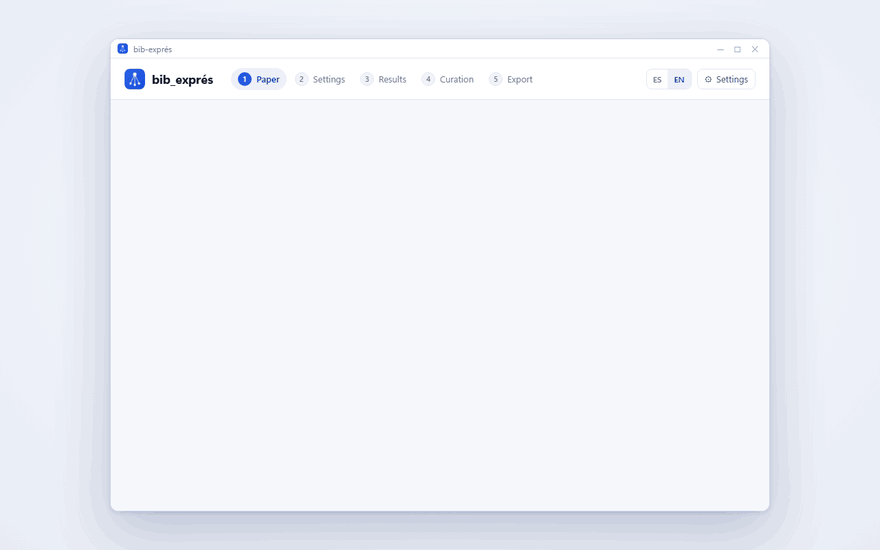

<div align="center">


# bib_exprés

**From one paper to a full bibliography — no black boxes.**

**English** · [Español](README.es.md)

[](https://github.com/AIAYN-creator/Bib-Expres/releases/latest)
[](LICENSE)



</div>

## What it does

Give it **one paper** (a DOI, an arXiv ID, a title or the PDF itself) and bib_exprés does the *snowballing* for you. It follows the paper's references, the papers that cite it and similar articles, keeps everything it sees, and picks the best ones with a score you can read: **how close the topic is, how many papers in your search point to it, and which keywords it shares with yours**. You get a bibliography ready for Zotero, LaTeX or Excel, and every entry can tell you why it is there.

```
input paper
  -> resolution (CrossRef + OpenAlex)                  -> root paper
  -> exploration (best first, up to 21 papers by default)
       -> OpenAlex: references + citations
       -> Semantic Scholar: similar articles (optional)
       -> every candidate seen is kept, with how many explored papers link to it
  -> selection: relevance + connections + shared keywords -> the top N, then the filters
  -> optional curation (keep / discard one by one)
  -> export -> .bib / .ris / .json / .xlsx
```

## Performance

**2.4× more of the literature that matters, in about a minute.** Measured against the bibliographies of three published reviews (machine learning, molecular biology, physics), bib_exprés v3 finds on average **24 %** of what each review cites among its top 200 results, against 9.9 % in v2; 50 % in the CRISPR case. A default search from *Attention Is All You Need* returns 200 articles out of 1,379 candidates in **~55 s with an empty cache**, mostly waiting for OpenAlex, and in a couple of seconds once it is cached. [Full v3 validation](docs/ejemplo-v3.md) (in Spanish) · benchmark in `benchmarks/`.

## Download and use

### Nothing to install (Windows)

**[Download `bib-expres-gui.exe` from Releases](https://github.com/AIAYN-creator/Bib-Expres/releases/latest)** (~17 MB) and run it. No Python needed. That link always points to the latest version, and every release publishes the `.exe`'s SHA-256 so you can verify the download.

Windows may warn you the first time because the `.exe` is not signed ("More info" > "Run anyway").

### With Python

```bash
pip install -e ".[dev]"
```

Desktop app (English or Spanish):

```bash
bib-expres-gui
```

Command line:

```bash
bib-expres --doi 10.1000/example --output bibliography.bib
bib-expres --input "Attention Is All You Need" --explain --output review.xlsx
```

Full guides: [installation and `.env`](docs/en/installation.md) · [every parameter](docs/en/usage.md) · [institutional access](docs/en/institutional-access.md).

## Features

- **Input**: DOI, arXiv ID or URL, free-text title (you pick among the candidates), or a PDF, which you can simply drop on the window.
- **An explainable algorithm**: every result shows its score breakdown ("Why?" in the app, `--explain` in the CLI, a *Why* column in Excel). Weights, generations, caps and the exploration budget are all configurable.
- **Filters**: document type, open access and **language**, Google Scholar style (the starting paper's language, or any). Filters choose what you see without cutting the search short.
- **Institutional access**: open the free version or go **through your library's proxy**, tick the publishers your institution covers, and hide what you can't read.
- **Tinder-style curation**: review each candidate with its abstract and keep or discard it with buttons, arrow keys or by dragging, with undo.
- **Live progress**: papers explored, candidates seen, "last activity X s ago" and a cancel button that keeps what was found so far.
- **Walk away while it searches**: a system notification (and a blinking taskbar icon) tells you when the search is done, if you're in another window.
- **Move freely**: "New search" right after exporting, and the steps in the header and the logo take you back to any screen you've already reached.
- **Daily quota at a glance**: how many searches OpenAlex's free quota still allows today, and when it resets.
- **Output**: BibTeX, RIS, CSL-JSON and **Excel** for literature reviews (title, authors, linked DOI, topic, keywords, relevance, why, access and a free column for notes).
- **A desktop app in English and Spanish**, light or dark.

## Data sources

- **OpenAlex** (primary): references, citations, topics, keywords, publishers and open-access links. No API key; about 1,000 free requests a day, roughly 13 new searches (repeated ones come from the local cache).
- **Semantic Scholar** (complement): similar articles. Works best with a free API key.
- **CrossRef**: DOI resolution and verification.

## Related work

bib_exprés is not the first tool for exploring the literature around a paper. Some tools in the same space:

- **[Connected Papers](https://www.connectedpapers.com/)**: a visual explorer that draws a graph of related papers by co-citation. Built for visual exploration, not for producing an exportable bibliography with configurable rules.
- **[ResearchRabbit](https://www.researchrabbit.ai/)**: similar in spirit ("Spotify for papers"), with collections and discovery by similarity and citations, also centred on interactive visual exploration.
- **[Litmaps](https://www.litmaps.com/)**: maps how a citation network evolves over time, aimed at keeping literature reviews up to date.
- **[ASReview](https://asreview.nl/)**: open-source, but it solves a different problem. Given a large set of candidates (e.g. exported from a database), it uses active learning to prioritise which ones to screen first in a systematic review.

What makes bib_exprés different: it is a command-line tool, library and desktop app (not a web app), with a configurable, transparent expansion and relevance algorithm, and its output is a bibliography file ready for a reference manager, LaTeX or Excel, not a visual graph to explore by hand.

## Limitations

- It only finds what **OpenAlex, Semantic Scholar or CrossRef** have indexed. Very new, very niche or non-indexed papers will not show up.
- The bibliography is always a **bounded subset** (by generations, exploration budget and article cap), not "everything related". Very broad reviews of older fields are covered worse: in the benchmark, the graphene review (455 references, many of them theory papers older than the starting paper) stays at ~5 %.
- **OpenAlex's free quota** allows about 13 new searches a day. The app shows how many are left and, when it runs out, says how long to wait instead of hanging.
- "Similar" mode works best with a Semantic Scholar API key.
- The score is a **simple, transparent formula** (topic, citations, recency, connections, keywords), not a language model or embeddings. It favours being able to explain every result over the sophistication of an ML approach.
- **Institutional access is approximate**: there is no public source of what your library actually pays for, so it relies on open-access data and the publishers you tick. A contract doesn't always cover every journal or year.
- The **language filter** depends on the language OpenAlex detects, which is sometimes wrong, and it can only keep papers that exist within reach: from *Attention Is All You Need* there are no Spanish papers among the 1,379 candidates.
- The `.exe` is not signed. Windows may show a SmartScreen warning the first time, and antivirus software may briefly block it right after building.
- Looking up the root paper by arXiv ID fails if the paper was later published elsewhere under its own DOI (common for well-known ML papers). Searching by title does not have this problem.
- The root paper is never dropped by any filter or by relevance: it always appears in the final result.

## Roadmap

Where bib_exprés has been and where it might go: **[ROADMAP.md](ROADMAP.md)**. Want to help? See **[CONTRIBUTING.md](CONTRIBUTING.md)**.

## Version history

### v3.1.0: a notification when the search is done, and moving freely between screens

- **Walk away while it searches.** When a search finishes (or stops) and the app is not the window you're looking at, you get a **system notification** with the result ("Search finished · 200 articles out of 1,379 candidates · Attention Is All You Need") and the **taskbar icon blinks** until you come back. On Windows it shows with bib_exprés's own name and logo; macOS and Linux use their own notifications. It can be turned off, and tested, in Settings.
- **Moving between screens feels natural.** After exporting there's a **"New search"** button that takes you straight back to the start with the field ready. The **steps in the header** (Paper, Settings, Results, Export) and the **logo** are now clickable and take you to any screen you've already reached; your results stay there until the next search.
- The [roadmap](ROADMAP.md) now has its own page, and there's a [CONTRIBUTING.md](CONTRIBUTING.md).

### v3.0.0: an explainable algorithm that finds 2.4× more, institutional access, language filter and a new bilingual app

**Why a major version**: with the same input and settings, the results are not the same as in v2. They are better, and measured.

- **A new algorithm, still no black box.** v2 kept the first good candidates it ran into until the cap was full. v3 explores the same citation graph but **keeps everything it sees and picks at the end**, adding two signals to topical relevance: **connections** (how many of the explored papers point to a candidate) and **shared keywords** with the starting paper. Against the bibliographies of three published reviews, recall@200 goes from **9.9 % to 24.0 %** (CRISPR: 18.6 % → 50 %). Every result explains its score: "Why?" in the app, `--explain` in the CLI, a *Why* column in Excel. The cost: a default search takes about 55 s instead of ~36 s with an empty cache, because it explores everything before picking. Benchmark and experiments in `benchmarks/`.
- **Filters no longer cut the search short.** Type, open access and language are applied when picking, so a paper you filter out can still lead to others you want.
- **Language filter**, Google Scholar style: the starting paper's language, a list of languages, or any (`--language`).
- **Institutional access**: a link to the free version when there is one, or **through your library's proxy** (EZproxy, OpenAthens, OpenURL); tick the publishers your institution covers and hide what you can't read (`--library-link`, `--publishers`, `--accessible-only`). Approximate by design: there is no public source of what a library actually pays for. Guide in [docs/en/institutional-access.md](docs/en/institutional-access.md).
- **A redesigned desktop app**: the logo's colours, **English or Spanish**, light or dark, steps in the header, drop a PDF on the window, results you can sort and search, undo in curation, an export screen with a summary and "Open folder", and **how many searches OpenAlex's free daily quota still allows**, with when it resets.
- **Security**: exports can only go to a path chosen in the native save dialog, the page can only call the Python methods it needs, a Content-Security-Policy blocks anything that isn't the app's own, and settings values are quoted so a `#` isn't lost.
- **Documentation in English** (`docs/en/`) and a demo GIF at the top of the README.

### v2.3.0: progress bar, Excel export, a bilingual README and no more silent hangs

- **Live progress while searching**: a progress bar with articles found over the cap, the generation and the paper being explored, plus "last activity X s ago" so you can tell a slow search from a stuck one (after 30 s it says the APIs are slow but the search is still running). A **Cancel** button stops the search and keeps what was found so far. The CLI shows the same as a single line on `stderr`; `--quiet` hides it.
- **Excel export for literature reviews** (`--format xlsx`, or "Excel" in the app): title, authors, DOI as a link, topic, keywords, relevance score, and an empty "Other notes" column. Frozen header and filters, so sorting by author or by relevance is one click. Any text starting with `=` is stored as plain text, never as a formula.
- **README in English** with a Spanish version (`README.es.md`), reorganised: what it does, the benchmark, download and use first, version history last.
- **Fixed: the app could hang for hours in silence** when OpenAlex rate-limits requests (too many in a short time, or the daily quota used up). OpenAlex then asks to wait, sometimes around 10 hours, and bib_exprés used to obey without limit. Now short waits (up to 30 s) are retried as before, and longer ones stop the search right away with a clear message saying how long to wait. Everything already fetched stays in the local cache, so retrying later costs fewer requests. Affected every earlier version.
- New dependency: `openpyxl`. The `.exe` grows from ~16.4 MB to ~17 MB.

### v2.2.0: security patch, outdated libraries inside the `.exe`

A second security audit, focused on what v2 added (the `.exe` and the GUI), found that the published `.exe` bundled three libraries with known vulnerabilities, disclosed *after* it was built:

- **`pypdf`** (reads the PDF when you give a PDF as the root paper): a crafted PDF could hang the app or eat up its memory. No code execution, but it could freeze the app with a file that usually comes from the internet.
- **`urllib3`** (the HTTP connection to the APIs): flaws in how it limits very large compressed responses.
- **`certifi`** (the list of certificate authorities the HTTPS connection trusts): it included an authority that has since been distrusted.

**Fixed**:

- All three libraries updated to versions with no known issues.
- The `.exe` is built from exact versions pinned in `packaging/requirements-build.txt`.
- CI runs `pip-audit` **every week**, even without commits. The root cause behind this patch is that it used to audit only on push.
- Minor fixes along the way:
  - An odd PDF no longer leaves the GUI waiting with no message.
  - The 10 MB response limit is enforced while downloading.
  - Settings no longer accept line breaks that would break the `.env`.
- Every release publishes the `.exe`'s SHA-256 ([how to check it](docs/instalacion.md), in Spanish).

Nothing to do manually beyond downloading the new `.exe` or updating with `pip install -e .`.

### v2.1.1: custom icon for `bib-expres-gui.exe`

The `.exe` shipped with PyInstaller's generic icon: the `.spec` did not declare one, and `pywebview`'s icon parameter only works on GTK/QT, not on Windows. Added `packaging/icon.ico` (a root node branching into three, the citation snowballing the app does), referenced from `EXE(icon=...)`. No behaviour changes.

### v2.1.0: security patch, unescaped DOIs in HTTP requests

bib_exprés put the DOI straight into the URL path when requesting metadata from OpenAlex, CrossRef and Semantic Scholar, without escaping special characters. A valid DOI can contain `/`, `:`, `;`, `(` and `)`, so a crafted DOI could alter the actual request sent to those APIs. The most sensitive case was "similar" mode, where each candidate's DOI comes straight from Semantic Scholar's response.

**Fixed**: the four places where a DOI (or OpenAlex's internal ID) was interpolated into the path now escape it first (`urllib.parse.quote`). Checked against the three real APIs that a normal DOI still resolves exactly as before.

### v2.0.0: desktop app, `.exe` and curation

- Desktop GUI (`bib-expres-gui`) and a downloadable standalone `.exe`.
- Tinder-style curation of results.
- Input by arXiv ID/URL, free-text title and PDF.
- RIS and CSL-JSON output, besides BibTeX.
- Document-type and open-access filters.

Validated against real data and with real clicks inside the window ([v2 example](docs/ejemplo-v2.md), in Spanish). Ruled out for now: authentication, which would only make sense if this were offered as a service to third parties.

### v1: end-to-end CLI

DOI-based snowballing from the command line with BibTeX output: 200 articles in ~22 seconds ([example](docs/ejemplo.md), in Spanish).

## License

MIT. See [LICENSE](LICENSE).
